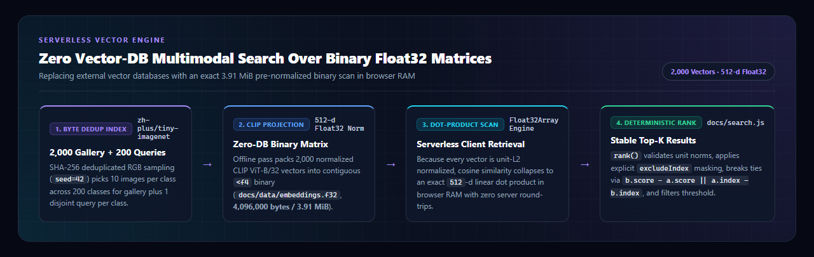
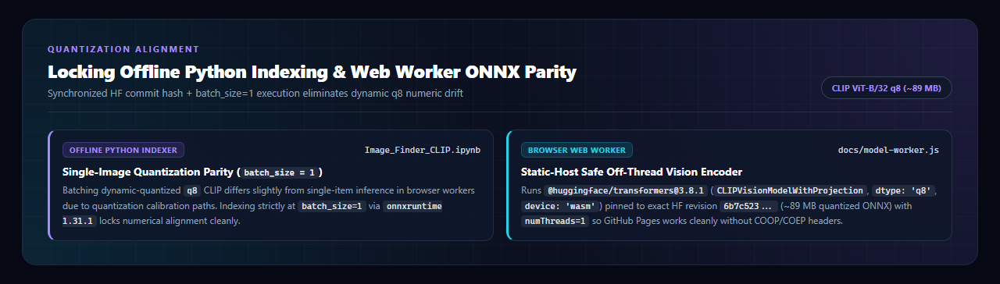
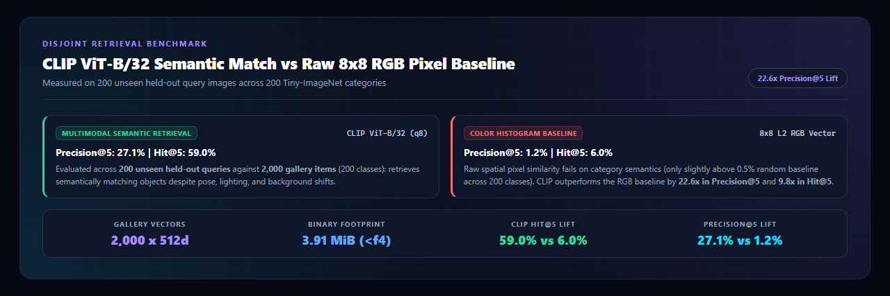
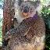
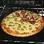
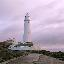
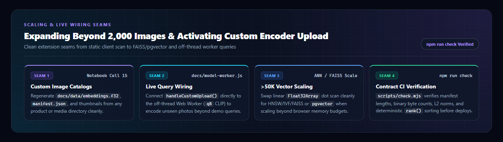

# LensVector — Zero-Shot Visual Similarity Search (`CLIP ViT-B/32` Binary Engine)

**Client-Side 512-Dimensional Multimodal Nearest-Neighbor Retrieval Over `2,000` Deduplicated Gallery Vectors (`3.91 MiB` Binary Matrix), Outperforming Raw Color Baselines by `22.6x` in Precision@5**

[-10B981?style=for-the-badge)](#disjoint-retrieval-evaluation-vs-rgb-baseline)

[Live Search Engine](https://abdulqader-alshihabi.github.io/Visual-Similarity-Search/) &nbsp;|&nbsp; [Architecture](#serverless-vector-engine-architecture) &nbsp;|&nbsp; [Quantization Parity](#cross-environment-quantization-parity) &nbsp;|&nbsp; [Benchmarks](#disjoint-retrieval-evaluation-vs-rgb-baseline) &nbsp;|&nbsp; [Extensibility](#scaling--live-worker-extensibility)

---

| System Dimension | Verified Specification | Engineering Guarantee |
| :--- | :--- | :--- |
| **Multimodal Encoder** | `Xenova/clip-vit-base-patch32` (`q8`) | Revision-pinned (`6b7c523...`) `~89 MB` quantized vision projection |
| **Dataset Scope** | `zh-plus/tiny-imagenet` (`valid` split) | `2,000` gallery (`10/class`) + `200` disjoint queries across `200` classes |
| **Binary Index Matrix** | `docs/data/embeddings.f32` (`4,096,000 B`) | `2,000 x 512 x float32` (`3.91 MiB`) pre-L2-normalized `<f4` binary |
| **Retrieval Precision@5** | **`27.1%`** (`CLIP ViT-B/32 q8`) | **`22.6x`** higher than `8x8 RGB` baseline (`1.2%`) on unseen queries |
| **Retrieval Hit@5** | **`59.0%`** (`CLIP ViT-B/32 q8`) | **`9.8x`** higher than `8x8 RGB` baseline (`6.0%`) across `200` classes |
| **Contract Verification** | `npm run check` (`scripts/check.mjs`) | Audits manifest length, byte size, unit norms, & deterministic `rank()` ties |

---

## Serverless Vector Engine Architecture

Standard visual similarity systems spin up heavy hosted vector databases (Milvus, Pinecone, Qdrant) even for medium-sized catalogs of a few thousand assets—introducing hosting costs, network latency, and API dependencies. By packing **2,000 unit-L2-normalized `512`-dimensional `float32` CLIP embeddings** into a single **`3.91 MiB` (`4,096,000` bytes)** raw binary file (`docs/data/embeddings.f32`), LensVector streams the entire embedding index directly into browser `Float32Array` memory and turns cosine similarity into an exact single-pass linear dot product.

  

### How Deterministic Browser Ranking Works (`docs/search.js`)

1. **Deduplicated Stratified Corpus:** Sampling (`seed=42`) hashes raw RGB pixels (SHA-256) to prevent near-duplicate leakage between gallery items (`10` images/class) and the held-out query split (`1` image/class across all `200` Tiny-ImageNet categories).
2. **Pre-Normalized Dot Product:** Since every row `v` in `embeddings.f32` satisfies `||v|| = 1`, cosine similarity reduces cleanly to `dot(q, v)` over typed `Float32Array` slices—avoiding per-query square-root normalization across all `2,000` candidates.
3. **Self-Query Exclusion & Stable Ordering (`rank()`):** Enforces unit-norm invariants, supports explicit `excludeIndex` suppression, applies the UI threshold filter (`50%–95%`, default `65%`, top `24`), and breaks ties deterministically via `b.score - a.score || a.index - b.index`.

---

## Cross-Environment Quantization Parity

Even minor numeric drift between an offline Python indexing job and an in-browser JavaScript encoder destroys cosine alignment. LensVector eliminates drift across both environments:

  

- **Synchronized Model Revision (`6b7c523...`):** Both offline indexing (`Image_Finder_CLIP.ipynb` via `onnxruntime 1.31.1`) and the off-thread browser encoder (`docs/model-worker.js` via `@huggingface/transformers@3.8.1`) pin the exact same quantized `Xenova/clip-vit-base-patch32` commit hash.
- **Single-Item Dynamic `q8` Calibration (`batch_size = 1`):** Batching dynamic-quantized ONNX operators alters activation ranges relative to single-image user uploads in the browser. Running offline index extraction strictly with `batch_size = 1` guarantees representation parity.
- **Static-Host Web Worker Execution:** `docs/model-worker.js` configures `env.backends.onnx.wasm.numThreads = 1` and streams progress cleanly so static hosts (GitHub Pages) run CLIP WASM off the main UI thread without requiring COOP/COEP cross-origin isolation headers.

---

## Disjoint Retrieval Evaluation vs. RGB Baseline

Evaluated rigorously inside `Image_Finder_CLIP.ipynb` Cell 11 across **`200` unseen held-out query images** matched against the **`2,000`-image gallery**:

  

| Retrieval Method | Representation | Precision@5 | Hit@5 | Improvement Over Baseline |
| :--- | :--- | :--- | :--- | :--- |
| **`CLIP ViT-B/32 (q8)`** | `512`-d L2 Multimodal Vision Embedding | **`27.1%`** (`0.271`) | **`59.0%`** (`0.590`) | **`22.6x` Precision@5 · `9.8x` Hit@5** |
| **Pixel Color Baseline** | `8x8` L2-Normalized RGB Vector (`192`-d) | `1.2%` (`0.012`) | `6.0%` (`0.060`) | Marginally above `0.5%` random (`1/200`) |

### Representative Held-Out Visual Query Samples (`docs/data/images/`)

Six unseen query categories (`koala`, `school bus`, `pizza`, `beacon`, `basketball`, `mushroom`) ship cleanly in `manifest.samples` (`docs/data/images/sample-*.png`) alongside their `2,000` indexed gallery thumbnails (`0000.png`–`1999.png`) for instantaneous zero-download visual exploration.

  
  &nbsp;&nbsp;
  
  &nbsp;&nbsp;
  
  &nbsp;&nbsp;
  
  &nbsp;&nbsp;
  
  &nbsp;&nbsp;
  
  
<em>Disjoint Held-Out Query Probes (`sample-11/134/181/65/62/195.png`) matching across pose, crop, and background variations.</em>

---

## Scaling & Live Worker Extensibility

  

- **Browser Frontend Wiring Note:** Both the deterministic `rank()` utility (`docs/search.js`) and the quantized `@huggingface/transformers@3.8.1` CLIP encoder worker (`docs/model-worker.js`) are verified and present in-repo. For instant static GitHub Pages responsiveness without forcing an `~89 MB` first-visit download, `docs/app.js` currently executes inline dot-product retrieval across pre-embedded probes (`handleCustomUpload()` maps to demo query `manifest.samples[1].vector`), making live custom-upload CLIP encoding a clean single-function hook into `model-worker.js`.
- **Rebuilding for Any Catalog:** Run `Image_Finder_CLIP.ipynb` Cell 15 to regenerate `embeddings.f32`, `manifest.json`, and thumbnails, then execute **`npm run check`** (`node scripts/check.mjs`) to verify vector byte alignment, unit norms, and notebook parity.

[Open Visual Search Engine](https://abdulqader-alshihabi.github.io/Visual-Similarity-Search/) &nbsp;|&nbsp; [Portfolio](https://abdulqader-alshihabi.github.io/) &nbsp;|&nbsp; [LinkedIn](https://www.linkedin.com/in/abdulqader-alshihabi-859b19260/) &nbsp;|&nbsp; Built by **Abdulqader Alshihabi**

